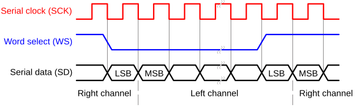
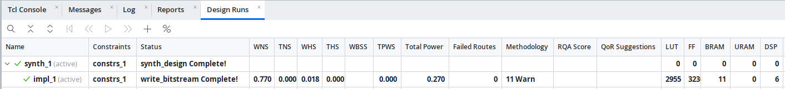
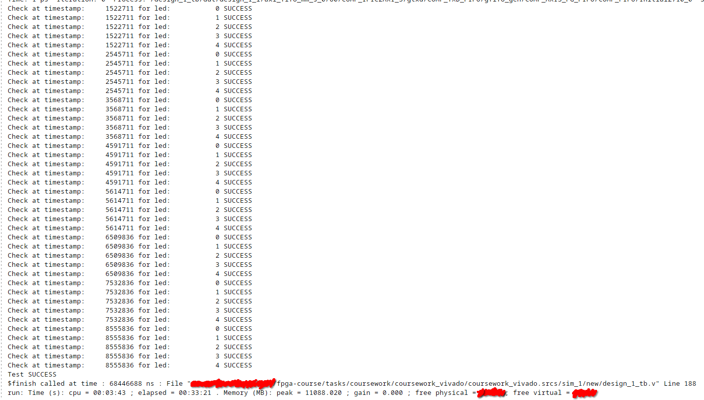
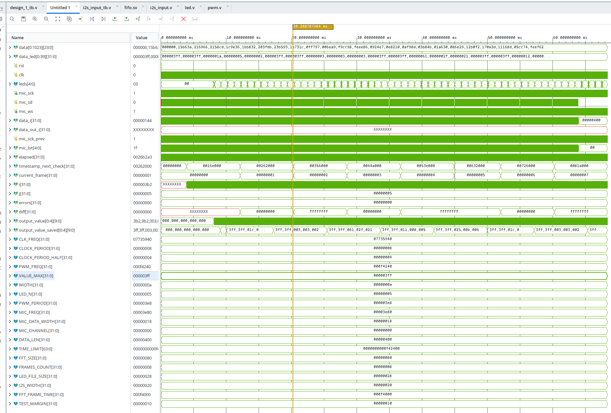

# Курсова робота по курсу FPGA
## Тема: візуальна індикація спектру звуку

### В курсовій роботі зроблено наступне
- Отримання звукових відліків по шині I2S в PL
- Накопичення сигналу в Microblaze
- Виконання FFT в IP через AXI шину
- Стискання половини частот спектру без DC (63 біни) до 5 смуг для світлодіодів в Microblaze
- Вивід яскравості світлодіода через PWM в PL

### Апаратні компоненти
- Плата Pynq-Z2
- Мікрофон INMP441 з I2S шиною (16 кГц, 24 біт)
- PMOD модуль з світлодіодами

### Параметри проєкту для симуляції
- Розмір FFT - 128
- Час сигналу - 64 мс
- Тактова частота - 125 МГц
- Частота ШІМ - 1 МГц
- Кількість рівнів ШІМ - 1024
- Допустима похибка ШІМ (TEST_MARGIN) - 16
- Кількість світлодіодів - 5
- Вибраний канал мікрофона - лівий (WS=0)
- Частоти (Гц) і амплітуди (відносні) сигналу: 300 (0.7), 700 (0.5), 1000 (0.5), 1300 (0.2), 2600 (0.4)

### Теорія
#### I2S шина
В I2S подібно до SPI slave відправляє біт даних (SD) по clock сигналу (SCK).
Додатково використовується сигнал WS (Word select) для вибору каналу - правий/лівий.



### Опис симуляції
Для симуляції було написано наступні додаткові скрипти:
- `gen_signal.py` - генерація HEX файлу з сигналом, який містить одну, або більше синусоїд
- `gen_leds.py`- читає файл, згенерований `gen_signal.py`, робить FFT і записує в HEX файл значення світлодіодів

Для запуску скриптів необхідна бібліотека `numpy`.

Приклади запуску скриптів:
```bash
uv run gen_signal.py --signals 300 700 1000 1300 2600 --amp 0.7 0.5 0.5 0.2 0.4 --time 0.064 signal.mem
uv run gen_leds.py 128 5 signal.mem leds.mem
```

Симуляція читає файл `signal.mem` і порівнює результат з файлом `leds.mem`.

Для визначення яскравості світлодіода дані накопичуються в змінній `output_value` на протязі
періоду ШІМ (1024 мкс) і переносяться в `output_value_saved`. 

Зі зміщенням половини періоду FFT (приблизно 4 мс, для того, що би був час на обробку даних) з інтервалом
періоду FFT (приблизно 8 мс) порівнюється output_value_saved з даними з файлу `leds.mem` з можливою похибкою до 16.

### Опис компонентів проєкту

---

#### `fifo.v` - FIFO
Черга з шириною даних 32 біти і довжиною 16.

---

#### `i2s_input.v` - ввід звуку
З одного боку має I2S ввід, з іншого боку має вивід по AXI шині.
Для буферизації використовується FIFO з модуля `fifo.v`.
Містить лічильник, який рахує такти CLK для генерації тактів I2S SCK.

---

#### `pwm.v` - ШІМ модуль

---

#### `led.v` - модуль керування світлодіодами
Отримує дані по AXI шині і за допомогою модуля ШІМ генерує вихідний сигнал для п'яти світлодіодів.

---

#### `design_1.bd` - блок дизайн, який збирає всі компоненти разом

---

### Результати
Імплементація показала наступні результати:
- WNS - 0.770 ns
- WHS - 0.018 ns
- LUT - 2955
- FF - 323
- BRAM - 11
- DSP - 6

Перевірено лише в симуляції, бо плати немає.






